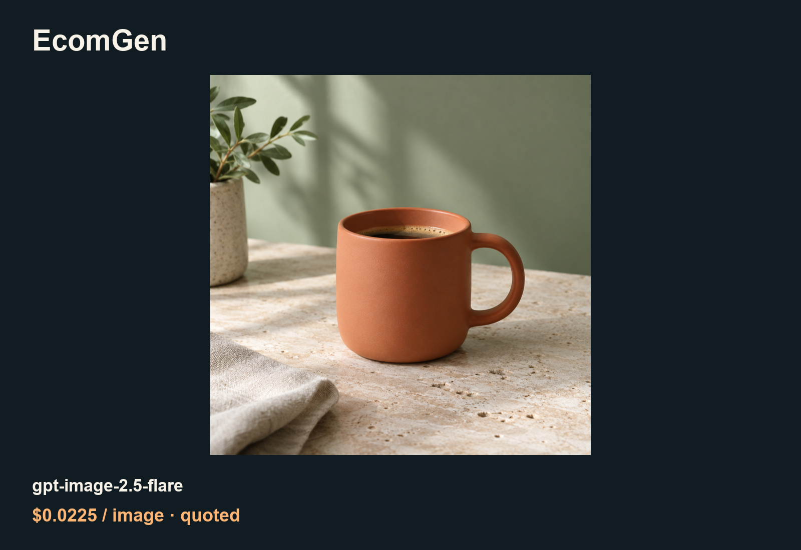

# Lower-cost media API guide for EcomGen

[English](README.md) · [中文](README_zh-CN.md)

Plan and review a reusable set of ecommerce product images.

An independently maintained ToAPIs community guide, not an endorsed app edition. [Original project](https://github.com/linbei0/EcomGen); [pinned source f8e6e7b5](https://github.com/linbei0/EcomGen/tree/f8e6e7b52c1ff74a614052728ccb24c2b4c5e7b6).

## Examples



## Case prices (2026-10-21)

| Model / settings | Rate | Case fee / source |
|---|---:|---|
| gpt-image-2.5-flare · high / 1K | $0.0225/image | Final image charge unavailable; same-key quote |

[Model landing page and current price](https://im25.toapis.com/1021_ec_gh) · [PRICING.md](PRICING.md)

## Validation scope

Optional ImageGenerationResult boundary passed with the real PNG. No edit/mask/transparency support is asserted. Worker registration and full upstream checks are pending.

## Generate and reuse

Use Python 3 and a private local `TOAPIS_API_KEY`; origin `https://toapis.com` without `/v1`. Query the price first; add `--live` explicitly to submit. Every run matches `/v1/pricing` for the same key and reads confirmed billing from submit/task responses.

```bash
python unified_client.py --model gpt-image-2.5-flare --prompt-file prompts/image.txt
python unified_client.py --model gpt-image-2.5-flare --prompt-file prompts/image.txt --max-usd 0.10 --run-id coffee-001 --live
```

The same inputs and run ID resume the original saved task. An uncertain submit stops rather than retrying. A new run ID is a new paid job.

[Project-specific integration](INTEGRATION.md) · [Sanitized case data](cases.json) · [Original prompts](prompts/)
