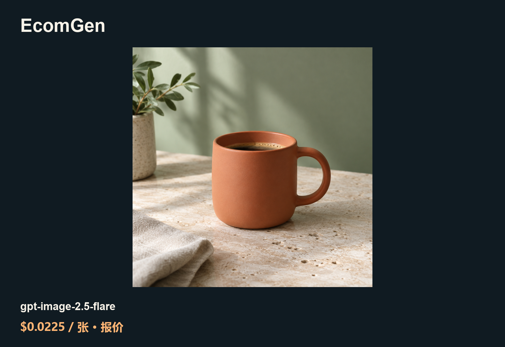

# 更低成本的 EcomGen API 素材方案

[English](README.md) · [中文](README_zh-CN.md)

把商品信息整理成分镜，生成和审核一套商品图。

这是 ToAPIs 独立维护的社区教程，不是上游官方版本。原项目：[linbei0/EcomGen](https://github.com/linbei0/EcomGen)；固定源码 [f8e6e7b5](https://github.com/linbei0/EcomGen/tree/f8e6e7b52c1ff74a614052728ccb24c2b4c5e7b6)。

## 演示



## 费用（2026-10-21）

| 模型／条件 | 单价 | 本案例费用／来源 |
|---|---:|---|
| gpt-image-2.5-flare · high / 1K | $0.0225/image | 实扣待回执；此数为同 Key 配置报价 |

[模型落地页与价格](https://im25.toapis.com/1021_ec_gh) · [PRICING.md](PRICING.md)

## 验证范围

可选 ImageGenerationResult 模块通过真实 PNG 返回核验；未声明编辑、蒙版、透明底能力。Worker 注册及完整上游检查待完成。

## 调用与复用

Python 3，仅在本机私有环境配置 `TOAPIS_API_KEY`，Base 为 `https://toapis.com`（不带 `/v1`）。先查询报价，再显式添加 `--live` 提交。每次调用均核对相同 Key 的 `/v1/pricing`；通过生成响应和任务查询读取已确认 billing。

```bash
python unified_client.py --model gpt-image-2.5-flare --prompt-file prompts/image.txt
python unified_client.py --model gpt-image-2.5-flare --prompt-file prompts/image.txt --max-usd 0.10 --run-id coffee-001 --live
```

相同输入与 run-id 恢复原任务；丢失提交响应时停止并核对，不自动重发。更换 run-id 是一次新的付费任务。

[Project-specific integration](INTEGRATION.md) · [Sanitized case data](cases.json) · [Original prompts](prompts/)
